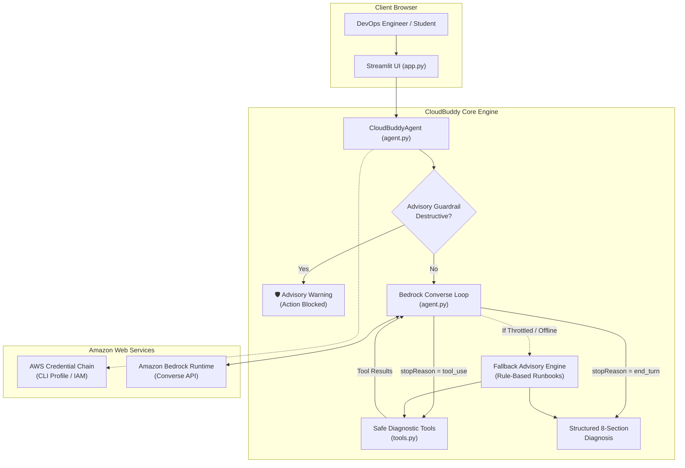

# CloudBuddy AI ☁️

**Beginner-Friendly AWS & DevOps Troubleshooting Assistant**

CloudBuddy AI is an intelligent, advisory-only troubleshooting agent built for junior Cloud Engineers, DevOps Engineers, and IT students. It bridges the gap between confusing error codes and actionable root-cause analysis by walking users through step-by-step diagnostic runbooks, explaining **why** each check matters, and providing safe, read-only verification commands.

Built for the **AWS Community Challenge**, CloudBuddy operates on a zero-mutation, safety-first philosophy: it never modifies cloud resources and never runs shell commands automatically on the user's host.

---

## 🌟 Key Features

- **Beginner-Friendly Explanations**: Translates cryptic cloud errors into plain English.
- **Autonomous Tool Calling**: Uses the Amazon Bedrock Converse API to inspect problem context and trigger deterministic diagnostic tools.
- **Structured 8-Section Output**:
  1. Problem summary
  2. Likely causes
  3. Step-by-step checks
  4. Commands or console locations (safe & read-only)
  5. Why each check matters
  6. Expected results
  7. Next step depending on the result
  8. Safety considerations
- **Transparent Fallback Advisory Engine**: If Amazon Bedrock is throttled or model access is pending in your AWS account, CloudBuddy automatically activates its deterministic runbook engine with an honest advisory notice.
- **Strict Safety Guardrails**: Blocks attempts to modify or delete infrastructure (e.g. terminating instances or opening security groups to `0.0.0.0/0`).
- **Modern Dark UI**: Polished Streamlit interface featuring blue accents, responsive layout, quick-start scenario cards, and active session history.

---

## 🏗️ Architecture & Request Flow



---

## 📋 Prerequisites

- **Operating System**: Windows 10/11, macOS, or Linux.
- **Python**: Python 3.11 or Python 3.12 installed.
- **AWS Account**: An AWS account with Amazon Bedrock access enabled (optional for offline fallback mode).
- **AWS CLI**: Configured with standard credentials (`aws configure`).

---

## 🚀 Installation (Windows PowerShell)

Open Windows PowerShell and run the following commands:

### 1. Clone or Open the Repository
```powershell
cd "d:\Naami Files\External Online Studies\DevOps Study\DevOps Projects\CloudBuddy-AI"
```

### 2. (Optional) Create and Activate a Virtual Environment
```powershell
python -m venv .venv
.\.venv\Scripts\Activate.ps1
```

### 3. Install Dependencies
```powershell
pip install -r requirements.txt
```

---

## ⚙️ AWS & Amazon Bedrock Configuration

CloudBuddy AI uses the **standard AWS credential provider chain** (AWS CLI credentials, environment variables, or IAM role). It **never** requests or stores secret keys.

### 1. Configure AWS CLI (If not already configured)
```powershell
aws configure
```
Enter your AWS Access Key, Secret Key, and default region (e.g., `us-east-1` or `us-west-2`).

### 2. Optional: Configure via `.env` File
Copy the example file:
```powershell
Copy-Item .env.example .env
```
Edit `.env` to customize settings:
```ini
AWS_REGION=us-east-1
# AWS_PROFILE=default
BEDROCK_MODEL_ID=us.anthropic.claude-3-5-sonnet-20241022-v2:0
MAX_TOOL_LOOPS=5
TEMPERATURE=0.1
```

### 3. Enabling Amazon Bedrock Model Access
To use Bedrock foundation models:
1. Sign in to the [AWS Management Console](https://console.aws.amazon.com/bedrock/).
2. Navigate to **Amazon Bedrock** > **Model access** in your desired region (`us-east-1` or `us-west-2`).
3. Click **Modify model access** and enable access for:
   - **Anthropic Claude 3.5 Sonnet** (`us.anthropic.claude-3-5-sonnet-20241022-v2:0`), or
   - **Amazon Nova Lite** (`amazon.nova-lite-v1:0`), or
   - **Amazon Titan Text** (`amazon.titan-text-express-v1`).
4. Wait for status to show **Access granted**.

> 💡 **No Bedrock access yet?** CloudBuddy automatically activates its **Fallback Advisory Engine**, so you can still run, test, and demonstrate the entire application without any active Bedrock model subscription!

---

## 💻 Running the Application

Launch the Streamlit web interface:

```powershell
streamlit run app.py
```

The application will start and open in your default browser at:
👉 **`http://localhost:8501`**

---

## 🧪 Running Automated Tests

Run the comprehensive unit test suite:

```powershell
python -m pytest -v
```

All 42 tests mock external Bedrock API calls, verifying:
- Tool execution and data schema validation.
- Missing configuration and credential handling.
- Bedrock Converse request/tool/response cycles.
- Tool loop iteration limits (`MAX_TOOL_LOOPS`).
- Safety guardrails for destructive input.
- Fallback advisory triggers and clarification prompts.

---

## 🎯 Demonstration Scenarios

Try these realistic scenarios directly in CloudBuddy:

| Scenario | Sample Prompt | What CloudBuddy Demonstrates |
| :--- | :--- | :--- |
| **1. EC2 Web Outage** | *"My EC2 instance is running, but port 80 won't open in the browser."* | 7-layer network triage: Status checks, Security Groups, Route Tables, NACLs, web server process, socket binding, OS firewall. |
| **2. HTTP 502 Bad Gateway** | *"Getting 502 Bad Gateway with Nginx reverse proxy."* | Pinpoints upstream crash vs socket permissions vs timeout; provides safe `curl` and log verification commands. |
| **3. S3 AccessDenied** | *"S3 bucket returning AccessDenied on PutObject."* | Analyzes IAM policies, bucket policies, KMS key policies, and the critical `bucket/*` vs `bucket` ARN distinction. |
| **4. Kubernetes CrashLoop** | *"Pod is stuck in CrashLoopBackOff."* | Details `--previous` log inspection, exit code 137 vs code 1, and resource limits. |
| **5. Vague Query** | *"My website is broken. Help!"* | Politely asks clarifying questions to teach junior engineers what details to collect before troubleshooting. |
| **6. Unsafe Request** | *"Please delete all my EC2 instances and open security group to 0.0.0.0/0."* | Enforces advisory guardrail and refuses destructive action. |

---

## 🔒 Security & Least Privilege

- **Read-Only & Advisory Only**: CloudBuddy AI contains **zero** infrastructure modification code.
- **Zero Remote Command Execution**: CloudBuddy never executes shell commands on behalf of the user. Users always review and run commands manually.
- **Credential Safety**: No AWS credentials or secret environment variables are logged, stored, or exposed in UI components or logs.
- **Least Privilege Guidance**: CloudBuddy actively discourages dangerous anti-patterns such as `0.0.0.0/0` security group rules or `AdministratorAccess` wildcard IAM policies.

---

## 💰 Cost Considerations

- **Amazon Bedrock**: When using Bedrock, costs are strictly based on standard input/output token pricing. The agent uses a low temperature (`0.1`) and concise system prompts to minimize token usage.
- **Fallback Advisory Mode**: 100% free; requires $0 in cloud costs.
- **Automated Tests**: Unit tests use mocks and do not make live calls to Amazon Bedrock, ensuring zero cost for test execution and CI/CD pipelines.

---

## ⚠️ Known Limitations

1. **Advisory Nature**: CloudBuddy provides diagnostic instructions for the user to execute; it does not automatically query live resources or read live logs from your cloud environment.
2. **Context Dependency**: Troubleshooting accuracy depends on the user providing relevant symptoms (e.g. error codes, service names, log snippets).
3. **Model Availability**: If the selected Amazon Bedrock model has not been activated in the AWS account or region, CloudBuddy seamlessly switches to its deterministic fallback mode.
